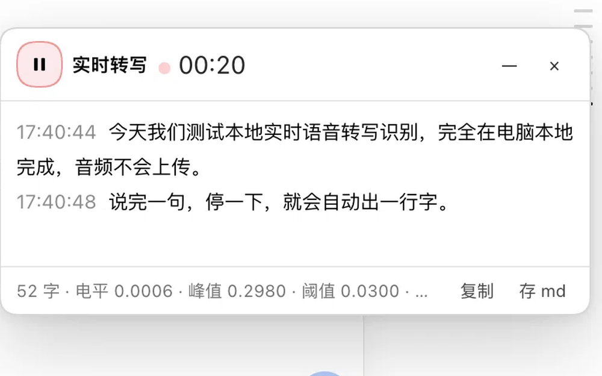

# dsh-plugin-local-voice

在 DeepSeek Harness 里做**本地实时语音转写**：右下角一个浮窗，边说边出字，可存成 markdown 纪要。识别引擎是本机的 **Qwen3-ASR-1.7B-8bit（MLX）**，音频不出机器。

> [English](README.en.md) | 简体中文



<sub>边说边出字：每句停 0.95 秒后出一行，可暂停/最小化继续录，可复制或存成 markdown。</sub>

## 安装

**方式一：直接从 GitHub 装（推荐，无需等待 npm）**

```bash
dsh plugin --profile desktop add github:R0tten-Git/dsh-plugin-local-voice
```

**方式二：插件页**

插件页 → **添加插件** → 指向本目录（或 `.tgz`）→ 安装 → 立即启用。

**方式三：npm（尚未发布，发布后可用）**

```bash
dsh plugin --profile desktop add dsh-plugin-local-voice
```

装完还要准备引擎（macOS Apple Silicon）：

```bash
uv venv ~/.local/venvs/mlx-audio --python 3.12
~/.local/venvs/mlx-audio/bin/pip install "mlx-audio==0.5.5" sounddevice numpy huggingface_hub

# 模型：默认走魔搭（国内快，不需要装 modelscope SDK）
python3 scripts/prepare_model.py
# 海外可换源：--source hf-mirror / --source hf
```

3. 重启 DSH，右下角出现 `🎙 实时转写`

## 平台支持

| 平台 | 浮窗 UI | Qwen3 引擎 | 说明 |
|---|---|---|---|
| macOS Apple Silicon | ✅ | ✅ | 推荐，中文效果最好 |
| Windows / Linux | ✅ | ❌ | 回落到官方 SenseVoice，UI 照常可用 |
| Web 客户端 | ✅ | 取决于 Host | 模型跑在 Host 上 |

## 使用

| 控件 | 作用 |
|---|---|
| 点右下角胶囊 | 开始录音并展开浮窗 |
| ▶ / ⏸ | 开始 / 暂停（暂停保留内容） |
| — | 最小化，继续录音 |
| × | 结束本次转写并清空（有内容时二次确认） |
| 复制 / 存 md | 复制全文 / 存成 markdown |

## 配置

| 环境变量 | 默认值 | 说明 |
|---|---|---|
| `LIVE_STT_MODEL` | `~/models/Qwen3-ASR-1.7B-8bit` | 模型目录 |
| `LIVE_STT_PYTHON` | `~/.local/venvs/mlx-audio/bin/python` | 带 mlx-audio 的解释器 |
| `LIVE_STT_MODEL_SOURCE` | `modelscope` | 缺模型时提示里用的镜像源 |
| `LIVE_STT_LLM_VERIFY` | `off` | 逐句 LLM 校对（走 DSH 模型通道） |

## 权限与网络

| 项 | 说明 |
|---|---|
| 麦克风 | 浏览器/系统层授权，录音只在页面内进行 |
| 本地进程 | 会拉起一个 Python 进程跑 Qwen3（只读模型目录，不写系统路径） |
| 网络 | **默认零外网**。模型下载是你手动执行脚本时才发生；`LIVE_STT_LLM_VERIFY=on` 会走 DSH 的模型通道 |
| 文件 | 只在用户点击「存 md / 存 wav」时通过系统文件选择器写入 |
| 数据 | 音频不落盘、不上传；日志写在 `~/Library/Logs/dsh-qwen3-asr.log` |

## 已知限制

- 依赖官方的**实验性**语音输入 Bundle，DSH 升级可能改 API
- Qwen3 引擎仅 Apple Silicon；其他平台回落 SenseVoice
- 模型不随包分发，需自行下载（镜像命令见上）

## 许可

MIT

---

# 开发笔记（历史）

最初这个包只做一件事：给 DSH 自带的语音输入加一个键盘快捷键（⌘D）。后来扩展成识别器 provider 和独立浮窗。

## 独立实时转写面板（v1.3.0）

除了快捷键和识别器，这个包现在还往输入框下方的 `conversation.composer.dock` 槽位注册一个**独立的实时转写面板**，跟内置语音输入完全无关：

- 右下角一个「🎙 实时转写」胶囊按钮；点一下开始录音并弹出浮窗（`shell.overlay` 槽位，380px 宽、最高 72vh，内容超出时窗内滚动）。
- 窗口左上角是**播放/暂停**同一个圆按钮：按一下开始，再按一下暂停；**暂停不清空**，再按继续往后面追加。
- 右上角 `—` 是**最小化**：窗口收起但**继续录音**，右下角只留一个半透明的小计时标记（`● 01:23`），开会时干活不受挡。
- 右上角 `×` 是**结束本次转写**：有内容时先变成红色「确认结束?」，3 秒内再点一次才清空并关闭，避免误删。
- 录音时显示红点、计时、已转句子数；**每说完一句（静音 0.7 秒）就出一行**，字幕实时往上滚。
- 音频在浏览器里做重采样（→16 kHz 单声道）与能量切句（自适应阈值：开头 1.2 秒静音校准，取中位数 ×3.5，夹在 0.008–0.05），每段编码成 WAV 后调 `ctx.remote.speech.transcribe`，也就是走本包的 `qwen3-asr-local` provider。
- 结束后可「复制」全文，或「存 md」——用 `showSaveFilePicker` 存到你选的位置，文件名默认 `live-stt-YYYY-MM-DD_HHMM.md`，内容带时间戳，可直接拿去整理纪要。
- 单段最长 9 秒强制切分，避免一个人长篇大论把内存吃光。
- 识别质量：worker 里有一张 `HOTWORDS` 领域词表（Qwen3-ASR 原生的 hotwords 偏置，在解码阶段压同音误识），以及一张极小的 `FIXES` 兜底替换表（只放正常中文里不会出现的错形，宁少勿多）。
- 纯语气词（嗯/啊/哦，≤2 字）会被当噪声丢弃，会议纪要里不占行。

## 模型来源（国内镜像优先）

模型不随包分发，用 `scripts/prepare_model.py` 自己下。三个源，默认魔搭：

```bash
# 魔搭 ModelScope（国内推荐，直链 17 MB/s，无需安装 modelscope SDK）
python3 scripts/prepare_model.py

# 只下某个文件 / 指定目录
python3 scripts/prepare_model.py --include config.json --dest /tmp/x

# 其他源
python3 scripts/prepare_model.py --source hf-mirror
python3 scripts/prepare_model.py --source hf
```

| `--flavor` | 仓库 | 大小 | 用途 |
|---|---|---|---|
| `mlx`（默认） | `mlx-community/Qwen3-ASR-1.7B-8bit` | 2.47 GB | macOS Apple Silicon |
| `hf` | `Qwen/Qwen3-ASR-1.7B-hf` | 4.09 GB | Windows/Linux 的 torch / onnx 后端 |

三个源上的仓库 id 完全一致（魔搭完整镜像了 HF 社区仓库），所以只换 URL 不换路径。
缺模型时插件日志会直接打印当前源对应的准备命令；用 `LIVE_STT_MODEL_SOURCE` 改默认源。

## 逐句 LLM 校对（v1.4.0）

**默认关闭。** 打开后，识别完每一句都会用 **DSH 自己配置的模型**（默认 `deepseek-account / deepseek-flash`）过一遍校对，再返回给 UI。位置在 Host 的 provider 里，所以实时转写面板和内置麦克风都生效。

开启方式：`LIVE_STT_LLM_VERIFY=on`（放在 DSH 的启动环境里）。

- 上下文：带上最近 2 句，用于术语一致（`浮窗` 不会一会儿变 `浮床`）。
- 只做最小改动：同音错字、专有名词、标点；严禁改写句式或增删信息。
- **所有失败路径回退原文**：超时（默认 2.5s）、模型报错、长度比异常（<0.5 或 >1.8）、模型开始解释自己做了什么——一律返回未校对的原文。
- 不到 4 个字的片段不调用（“好”“行”不值得一次请求）。
- 换模型：`LIVE_STT_LLM_MODEL` / `LIVE_STT_LLM_PROVIDER`；改超时：`LIVE_STT_LLM_TIMEOUT_MS`。
- 不打开时零开销：`verifyText` 第一步就返回原文，不读服务、不发请求。

代价要说清楚：这会把“完全离线”变成“依赖 DSH 的模型通道”，并且每句多 0.5–2 秒。一场一小时的会议约 300 句，就是 300 次调用。

## 本机新增：Qwen3-ASR 识别器（v1.2.0）

除了快捷键，这个包现在还注册一个**本地识别器 provider**，把内置麦克风的识别从自带的 SenseVoice 换成本机的 **Qwen3-ASR-1.7B-8bit（MLX）**：

- 识别器 id：`qwen3-asr-local`，在语音输入的语言下拉里可选 `auto / zh / en / yue / ja / ko`。
- `cordis.patch.yml` 把 `speech-to-text` 的 `defaultProvider` 直接指向它；若被更高层配置压住，插件启动时还会用服务自己的 `configure()` 再切一次。
- 真正的推理在 `qwen3_worker.py`：常驻 python 进程，**模型只 load 一次**，stdin/stdout 走 ndjson。
- 进程**懒启动**（第一次转写才拉起，约 1.1s 加载 + 0.6s 推理），空闲 5 分钟自动回收，所以光开着 DSH 不占那 2.4GB。
- 依赖：`~/.local/venvs/mlx-audio`（Python 3.12 + mlx-audio 0.5.5）与 `~/models/Qwen3-ASR-1.7B-8bit`。路径可用 `QWEN3_ASR_PYTHON` / `QWEN3_ASR_MODEL` 覆盖。
- 想换回 SenseVoice：删掉 `cordis.patch.yml` 里 `speech-to-text` 那三行，或在识别器下拉里手动选 `SenseVoiceSmall`。

> Host 侧的 JS 改动需要**重启一次 DSH** 才会加载（客户端 HMR 不管 Host 模块）。

## 环境要求

- DSH Desktop `0.2.0-rc.2`（本包针对随该版本打包的客户端 API 编写）。
- **语音输入 Bundle 已启用**，且识别模型已在本机准备好（插件页 → 官方 → 语音输入 → 启用；首次使用需“下载并准备”）。快捷键只负责按键；识别由上面的 Qwen3 provider（或自带 SenseVoice）完成。
- 麦克风权限：浏览器/系统层授权照旧由自带语音输入插件在首次录音时请求。

## 安装

复制这个包目录（或 `.tgz` 压缩包）到目标机器后，任选一种方式：

**A. 插件页（推荐给人工操作）**

1. 侧栏 **插件** → **添加插件**；
2. 填入包目录的**绝对路径**，或选择压缩包；
3. **安装** → 完成后点 **立即启用**；
4. 若界面没立刻生效，刷新页面或重启一次 DSH。

**B. 交给 DSH agent（`plugin_manager` 可用时）**

```
install_bundle(target: "<包目录绝对路径>", enabled: true)
```

安装后 `~/.dsh/profiles/<profile>/` 的 `package.json` 会多出这条依赖并把它加入 `dsh.profile.bundles`；`cordis.patch.yml` 由包自带，不需要手写。

## 默认键位

| 运行环境 | 默认键位 |
|---|---|
| Desktop（macOS） | `⌘D` |
| Desktop（Windows / Linux） | `Ctrl+D` |
| Web（macOS / Windows） | `⌘⇧D` / `Ctrl+Shift+D` |
| Web（Linux） | 不绑定（Web/Linux 只允许 `Mod+Slash`、`Mod+Shift+Comma/Period` 等少数组合） |

改键位：**设置 → 编辑快捷键**（或 `⌘/` 打开速查）→ 搜索「语音输入」。默认键位与 DSH 内置命令无冲突（内置占用 B/P/T/N/K/O/G/F/A/`、`、`/`、`\`、W、R、Comma、Backquote 等组合）。

## 行为

- 空闲时按下：点击麦克风 → 开始录音。
- 录音中按下：点击「停止并识别」→ 转写并插入草稿。
- 录音中按 `Esc`：取消（沿用自带插件的行为）。
- 转写/授权进行中：不打断，也不重复触发。
- 弹窗或菜单打开时：不动作。
- 麦克风不存在（语音输入 Bundle 未启用）或按钮禁用（会话运行中锁定）时：命令静默不动作。

## 实现与限制

- 自带语音输入插件没有对外服务，因此本插件通过它渲染的控件触发：
  1. 注册一条标准命令 `voice.dictate`（走 DSH 的 shortcuts 服务，可在设置里改键位）；
  2. 附带一个 DOM `keydown` 兜底：读取该命令的**当前生效键位**后自行匹配。macOS/Windows Desktop 的可配置命令只由原生桥分发，原生桥成功时主进程已消费事件、页面收不到，所以两条通路不会重复触发；只有原生桥漏掉时才由兜底接住。
- 麦克风按钮通过自带的本地化 `aria-label`（`开始录音` / `Start recording` / `打开语音输入引导` / `Open voice input setup`）定位，class 以 `_trigger` 结尾的按钮只作兜底。DSH 升级若改动这些文案，需要同步 `client.js` 里的 `TRIGGER_LABELS`。
- 排查问题：把 `client.js` 里的 `DIAGNOSTIC` 改成 `true`，触发时窗口顶部会显示一条黑底提示，写明走的是哪条通路、点了哪个元素、0.6 秒后是否出现录音栏。

## 卸载

插件页删除本包即可；它只注册一条命令和一个 DOM 监听，不写任何其他文件。
